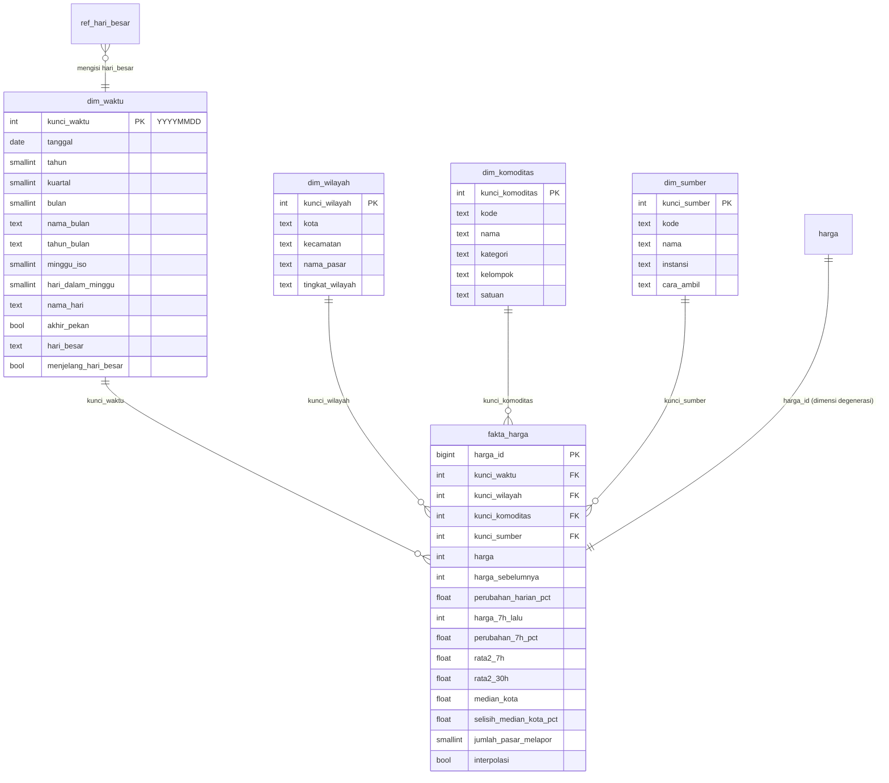

# Data warehouse (skema bintang)

Dibuat oleh migrasi `backend/migrations/000003_warehouse.up.sql`, yang berjalan otomatis saat backend menyala.
Tabel `harga`, view `harga_agregat`, dan seluruh API yang sudah ada **tidak berubah**; warehouse adalah lapisan
analitik di atasnya untuk dashboard visual lanjutan, EDA, dan pemodelan.

## ERD



GitHub menampilkan diagram di atas sebagai gambar. Untuk laporan, buka berkas ini di GitHub lalu ambil tangkapan layarnya,
atau tempel blok `mermaid` ke https://mermaid.live untuk mengunduh PNG/SVG.

## Grain dan isi

| Tabel | Grain (satu baris =) | Isi awal |
|---|---|---|
| `fakta_harga` | satu harga satu komoditas di satu pasar pada satu tanggal dari satu sumber (sama dengan satu baris `harga`) | 133.218 |
| `dim_waktu` | satu tanggal kalender | 2024-01-01 s.d. 2026-12-31 (diperluas otomatis bila data lebih baru) |
| `dim_wilayah` | satu pasar (hierarki: kota → kecamatan → pasar) | 21 pasar di 13 kecamatan |
| `dim_komoditas` | satu komoditas | 14 (kategori: Serealia, Kacang-kacangan, Bumbu dan sayur, Protein hewani, Minyak dan pemanis) |
| `dim_sumber` | satu sumber data | SIMPANG, SP2KP, PIHPS, BADANPANGAN |

Data sintetis (`sumber = 'DEV'`) tidak dimuat ke warehouse.

## Ukuran di tabel fakta

| Kolom | Arti |
|---|---|
| `harga` | harga yang dilaporkan (Rp per satuan komoditas) |
| `harga_sebelumnya`, `perubahan_harian_pct` | harga laporan sebelumnya pada deret yang sama (pasar, komoditas, sumber) dan perubahannya |
| `harga_7h_lalu`, `perubahan_7h_pct` | harga terakhir dalam rentang 7 sampai 14 hari sebelumnya, dan perubahannya; kosong bila tidak ada laporan di rentang itu |
| `rata2_7h`, `rata2_30h` | rata-rata bergerak 7 dan 30 hari kalender pada deret yang sama |
| `median_kota`, `selisih_median_kota_pct` | median harga semua pasar pada hari, komoditas, dan sumber yang sama, serta selisih pasar ini terhadapnya |
| `jumlah_pasar_melapor` | banyak pasar yang melapor pada hari, komoditas, dan sumber yang sama |
| `interpolasi` | selalu `false` saat ini (database hanya berisi data asli) |

Semua ukuran sudah dicocokkan dengan perhitungan pandas yang independen: 133.218 dari 133.218 baris sama.

## ETL ke warehouse (otomatis)

Fungsi `muat_warehouse(komoditas_dipilih)` mengisi dimensi baru lalu menghitung ulang fakta. Empat trigger tingkat
pernyataan pada tabel `harga` memanggilnya setiap ada tambah, ubah, hapus, impor, atau pengosongan data:

- **Impor CSV** (satu pernyataan `INSERT`, ribuan baris): satu kali muat untuk komoditas yang ada di berkas, sekitar 4 detik untuk 133 ribu baris.
- **CRUD satu baris:** hanya komoditas yang berubah yang dihitung ulang, sekitar 0,5 detik.
- **Impor ulang tanpa baris baru:** tidak ada yang dihitung ulang.

Memuat ulang semuanya secara manual (mis. setelah mengubah `ref_hari_besar`):

```sql
DELETE FROM dim_waktu WHERE NOT EXISTS (SELECT 1 FROM fakta_harga f WHERE f.kunci_waktu = dim_waktu.kunci_waktu);
UPDATE dim_waktu t SET hari_besar = (SELECT string_agg(nama, ', ') FROM ref_hari_besar r WHERE r.tanggal = t.tanggal),
       menjelang_hari_besar = EXISTS (SELECT 1 FROM ref_hari_besar r WHERE r.tanggal > t.tanggal AND r.tanggal <= t.tanggal + 7);
SELECT muat_warehouse();
```

Tanggal hari besar di `ref_hari_besar` (Tahun Baru, Imlek, Awal Ramadan, Idulfitri, Iduladha, Natal 2024–2026) perlu
dicocokkan dengan `ml/app/kalender.py` dan SKB 3 Menteri.

## Tampilan datar `v_dataset_harga`

Gabungan fakta dan keempat dimensi dalam **30 kolom** (campuran numerik dan kategorikal), untuk EDA di notebook,
ekspor, dan memenuhi syarat dataset ≥ 10 kolom:

```sql
SELECT * FROM v_dataset_harga WHERE komoditas = 'cabai_merah' LIMIT 10;
```

Dari Python:

```python
import pandas as pd
from sqlalchemy import create_engine
eng = create_engine("postgresql+psycopg2://<user>:<password>@localhost:<POSTGRES_HOST_PORT>/<db>")
df = pd.read_sql("SELECT * FROM v_dataset_harga", eng, parse_dates=["tanggal"])
```

## Contoh query untuk dashboard

Drill-down kota → kecamatan → pasar (rata-rata bulanan cabai merah):

```sql
SELECT w.kecamatan, w.nama_pasar, t.tahun_bulan, round(avg(f.harga)) AS rata2
FROM fakta_harga f
JOIN dim_waktu t USING (kunci_waktu)
JOIN dim_wilayah w USING (kunci_wilayah)
JOIN dim_komoditas k USING (kunci_komoditas)
WHERE k.kode = 'cabai_merah' AND t.tahun = 2026
GROUP BY ROLLUP (w.kecamatan, w.nama_pasar), t.tahun_bulan
ORDER BY t.tahun_bulan, w.kecamatan NULLS FIRST, w.nama_pasar NULLS FIRST;
```

Peta panas bulan × komoditas (perubahan harga rata-rata):

```sql
SELECT k.nama, t.tahun_bulan, round(avg(f.perubahan_7h_pct)::numeric, 2) AS rata2_perubahan_7h_pct
FROM fakta_harga f JOIN dim_waktu t USING (kunci_waktu) JOIN dim_komoditas k USING (kunci_komoditas)
GROUP BY k.nama, t.tahun_bulan ORDER BY k.nama, t.tahun_bulan;
```

Menjelang hari besar dibanding hari biasa (bahan storytelling):

```sql
SELECT k.kategori, t.menjelang_hari_besar, round(avg(f.perubahan_7h_pct)::numeric, 2) AS rata2_perubahan_7h_pct, count(*)
FROM fakta_harga f JOIN dim_waktu t USING (kunci_waktu) JOIN dim_komoditas k USING (kunci_komoditas)
GROUP BY 1, 2 ORDER BY 1, 2;
```

Hasil pada data sekarang: bumbu dan sayur naik rata-rata **5,33%** dalam 7 hari menjelang hari besar, dibanding **1,19%** pada hari biasa.

Sebaran harga antarpasar (bahan box plot):

```sql
SELECT k.nama, w.nama_pasar, f.harga
FROM fakta_harga f JOIN dim_wilayah w USING (kunci_wilayah) JOIN dim_komoditas k USING (kunci_komoditas)
JOIN dim_waktu t USING (kunci_waktu)
WHERE t.tahun_bulan = '2026-09';
```